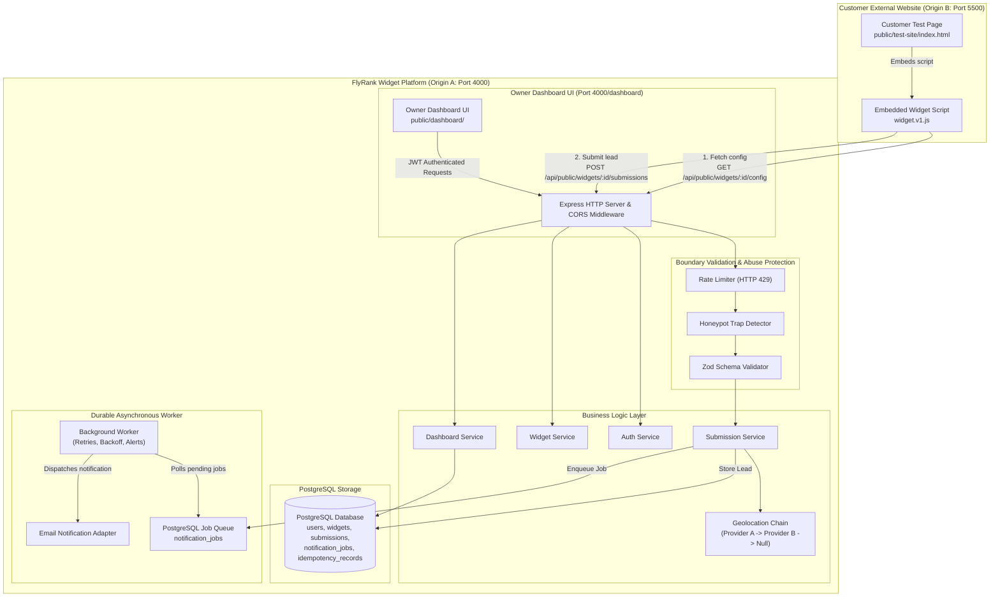

# FlyRank Embeddable Widget & Lead-Capture Platform
> **FlyRank Internship Backend Track Capstone Project**  
> An enterprise-grade, multi-tenant embeddable widget and lead capture platform with single-script embedding, strict tenant isolation, rate limiting, honeypot anti-spam, resilient geolocation fallback, durable PostgreSQL background notification jobs, and an owner analytics dashboard.

---

## 1. Project Overview & Key Features

The FlyRank Widget Platform provides end-to-end infrastructure for businesses to build, customize, and embed lead generation, contact, and call-to-action (CTA) widgets on external customer websites via a single `<script>` tag.

### Highlights:
- **Zero-Dependency Single Script Embedding**: External websites embed forms using `<script src=".../widget.v1.js" data-widget-id="..."></script>`. No extra JavaScript required.
- **Strict Multi-Tenant Isolation**: Owner data, widgets, lead submissions, and analytics are isolated at the database query level. Tenant A can never view, mutate, or delete Tenant B's assets.
- **Multi-Tier Abuse Protection**:
  - `express-rate-limit` throttles brute-force authentication and submission floods (returns `HTTP 429`).
  - Invisible honeypot trap (`website`) detects automated bots and silently drops spam without saving to PostgreSQL.
- **Resilient Geolocation Fallback Chain**: Client IPs are enriched with normalized geographical location via Provider A (`ip-api.com`), falling back to Provider B (`ipapi.co`), and gracefully continuing without failing if both are unavailable.
- **Durable PostgreSQL Job Queue**: Submission notification dispatch runs asynchronously with bounded exponential retries (up to 3 attempts), persisting state across server restarts and alerting upon retry exhaustion.
- **Safe DOM Rendering**: Built with DOM APIs (`document.createElement`, `textContent`) preventing Cross-Site Scripting (XSS).
- **Separate-Origin Verification**: Tested across distinct origins (API on Port 4000, Customer Test Site on Port 5500).
- **Hermetic Automated Test Suite**: 60 automated integration tests passing across all critical paths.

---

## 2. Technology Stack

- **Runtime**: Node.js (v24.x)
- **Backend Framework**: Express.js (v5.x)
- **Database**: PostgreSQL (v16.x) via `pg` connection pool with migrations and transactions
- **Authentication**: JWT (`jsonwebtoken`) & password hashing with `bcryptjs`
- **Validation**: Runtime schema validation via `zod` (v4.x)
- **Security**: `helmet`, `cors`, `express-rate-limit`, strict 10KB payload body parsing
- **Frontend**: Vanilla HTML5, CSS3 (glassmorphic dark UI), and modern JavaScript (zero heavy frameworks)
- **Testing**: Node.js native test runner (`node:test`, `node:assert`) and `supertest`
- **Containerization**: Docker & Docker Compose with PostgreSQL health checks

---

## 3. System Architecture Diagram



---

## 4. Database Model Overview

```
users (id PK, email UNIQUE, password_hash, name, created_at, updated_at)
  │
  ├──< widgets (id PK, owner_id FK, name, type, title, description, button_text, fields JSONB, display_settings JSONB, status)
  │      │
  │      └──< submissions (id PK, widget_id FK, owner_id FK, data JSONB, client_ip, geolocation JSONB, idempotency_key UNIQUE)
  │             │
  │             └──< notification_jobs (id PK, submission_id FK, widget_id FK, owner_id FK, payload JSONB, status, attempts, max_attempts, next_run_at)
  │
  └──< idempotency_records (key PK, widget_id FK, response_status, response_body JSONB, expires_at)
```

---

## 5. Setup & Running Instructions

### Prerequisites
- Node.js v18+ (tested on Node v24)
- npm v9+
- Optional: Docker and Docker Compose (if running inside containers)

### Quick Start (Local Node.js)
```powershell
# 1. Clone repository and navigate into project directory
cd flyrank-capstone-widget-platform

# 2. Install dependencies
npm install

# 3. Copy environment configuration
cp .env.example .env

# 4. Run automated test suite (hermetic, zero-cost, runs in ~1.2s)
npm test

# 5. Run end-to-end cross-origin integration test (Port 4000 & 5500)
npm run test:integration

# 6. Start the main API and dashboard server (Port 4000)
npm start

# 7. In a separate terminal, start the customer test website (Port 5500)
npm run test-site
```

### Running with Docker Compose
```powershell
# Build and launch PostgreSQL, Platform API, and Customer Test Site
docker compose up --build

# Run database migrations and seeds inside the container
docker compose exec app npm run db:migrate
docker compose exec app npm run db:seed
```

---

## 6. Development Demo Credentials

The reproducible seed command (`npm run db:seed`) creates two demo accounts:

| User | Email | Password | Role & Widgets Owned |
| :--- | :--- | :--- | :--- |
| **Alice Johnson** | `alice@example.com` | `Password123!` | Owner of *Newsletter Signup* and *Enterprise Contact* |
| **Bob Smith** | `bob@example.com` | `Password123!` | Owner of *AI Feature Waitlist* |

> **Security Note**: These credentials are strictly for local evaluation and testing. Never use these demo accounts in production.

---

## 7. URLs & Port Mapping

- **Owner Dashboard**: [http://localhost:4000/dashboard](http://localhost:4000/dashboard) (Login as Alice or Bob with 1-click demo buttons)
- **API Health Check**: [http://localhost:4000/health](http://localhost:4000/health)
- **Versioned Widget Asset**: [http://localhost:4000/widget.v1.js](http://localhost:4000/widget.v1.js)
- **Customer Test Website (Separate Origin)**: [http://localhost:5500](http://localhost:5500)

---

## 8. API Documentation

### Authentication

#### `POST /api/auth/register`
- **Body**: `{ "name": "Jane", "email": "jane@example.com", "password": "Password123!" }`
- **Response `201`**: `{ "user": { "id": "...", "email": "..." }, "token": "..." }`

#### `POST /api/auth/login`
- **Body**: `{ "email": "alice@example.com", "password": "Password123!" }`
- **Response `200`**: `{ "user": { ... }, "token": "..." }`

---

### Widget Management (Requires `Authorization: Bearer <TOKEN>`)

#### `GET /api/widgets`
- Returns all widgets belonging to the authenticated tenant.

#### `POST /api/widgets`
- **Body**:
  ```json
  {
    "name": "Beta Waitlist",
    "type": "cta",
    "title": "Join our Early Access Beta",
    "description": "Exclusive invites delivered weekly",
    "button_text": "Request Invite",
    "fields": [
      { "name": "email", "label": "Work Email", "type": "email", "required": true }
    ],
    "display_settings": { "theme": "dark", "primaryColor": "#6366f1" }
  }
  ```
- **Response `201`**: `{ "widget": { ... } }`

#### `GET /api/widgets/:id/embed`
- Generates embed snippet tailored for host websites.
- **Response `200`**:
  ```json
  {
    "widgetId": "aaaaaaaa-aaaa-4aaa-8aaa-aaaaaaaaaaaa",
    "snippet": "<script src=\"http://localhost:4000/widget.v1.js\" data-widget-id=\"aaaaaaaa-aaaa-4aaa-8aaa-aaaaaaaaaaaa\"></script><div id=\"flyrank-widget-aaaaaaaa-aaaa-4aaa-8aaa-aaaaaaaaaaaa\"></div>"
  }
  ```

---

### Public Endpoints (Cross-Origin Enabled)

#### `GET /api/public/widgets/:widgetId/config`
- **Headers Returned**: `Cache-Control: public, max-age=60, stale-while-revalidate=30`, `ETag`
- **Response `200`**: Public configuration without owner credentials.

#### `POST /api/public/widgets/:widgetId/submissions`
- **Headers**: `Content-Type: application/json`, `Idempotency-Key: <OPTIONAL_UUID>`
- **Body**: `{ "email": "visitor@example.com", "first_name": "Sarah", "website": "" }`
- **Response `201`**: `{ "success": true, "submissionId": "...", "message": "Submission received successfully" }`

---

## 9. Verification & Testing

### Run All Automated Tests
```powershell
npm test
```
**Observed Output**:
```
ℹ tests 60
ℹ pass 60
ℹ fail 0
ℹ duration_ms ~1600ms
```

### Demonstrating Spam Honeypot Protection
Submit a request with the invisible `website` field filled:
```bash
curl -X POST http://localhost:4000/api/public/widgets/aaaaaaaa-aaaa-4aaa-8aaa-aaaaaaaaaaaa/submissions \
  -H "Content-Type: application/json" \
  -d '{"email":"bot@spam.com","website":"http://spam-site.com"}'
```
**Result**: The server returns `201` to avoid alerting the bot, but structured logs record `[SPAM_DROPPED]` and the lead is **never stored** in the database.

### Demonstrating Rate Limiting (HTTP 429)
Send rapid requests to exceed the limit:
```bash
for i in {1..35}; do
  curl -s -o /dev/null -w "%{http_code}\n" -X POST http://localhost:4000/api/public/widgets/aaaaaaaa-aaaa-4aaa-8aaa-aaaaaaaaaaaa/submissions \
    -H "Content-Type: application/json" \
    -d '{"email":"lead@example.com"}'
done
```
**Result**: Requests 1–30 succeed; requests 31+ receive `HTTP 429 Too Many Requests`.

### Demonstrating Provider Failure Simulation
You can simulate failure in external services without modifying code:
- Set `GEO_PROVIDER_A_SIMULATE_FAIL=true` in `.env`: Provider A fails and system falls back to Provider B.
- Set both `GEO_PROVIDER_A_SIMULATE_FAIL=true` and `GEO_PROVIDER_B_SIMULATE_FAIL=true`: Both providers fail, and the submission still succeeds with `null` geolocation.
- Set `NOTIFICATION_SIMULATE_FAIL=true`: Background notification worker fails, retries with exponential backoff, and logs `[NOTIFICATION_JOB_EXHAUSTED]` after 3 attempts without affecting stored leads.

---

## 10. Security & Engineering Notes
- **Safe DOM APIs**: Untrusted strings in widget configuration are bound using `textContent`, never `innerHTML`.
- **Parameterized SQL**: All database queries use parameter placeholders (`$1, $2`) to eliminate SQL injection vulnerabilities.
- **Request Size Boundaries**: Body parser enforces a strict `10kb` limit to prevent denial-of-service memory exhaustion.
- **Secrets Sanitization**: The structured logger filters sensitive fields (`password`, `token`, `secret`, `authorization`) to ensure credentials never appear in server logs.
- **Graceful Shutdown**: The server listens for `SIGTERM` and `SIGINT`, cleanly terminating background workers and closing PostgreSQL connection pools.
